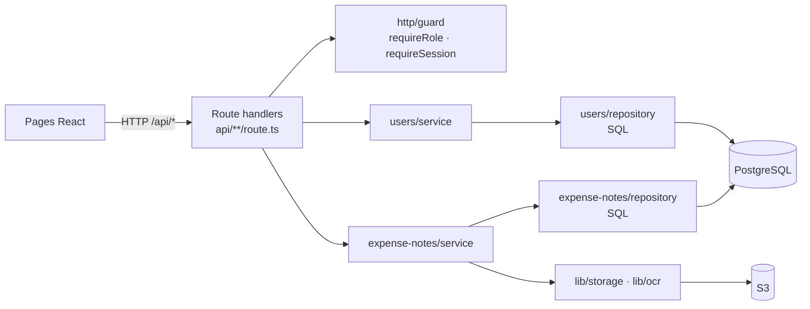
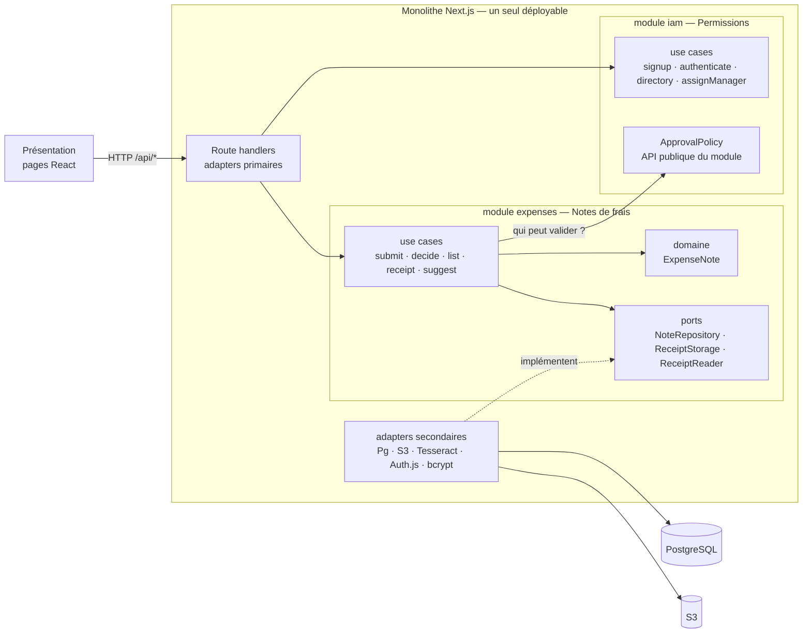
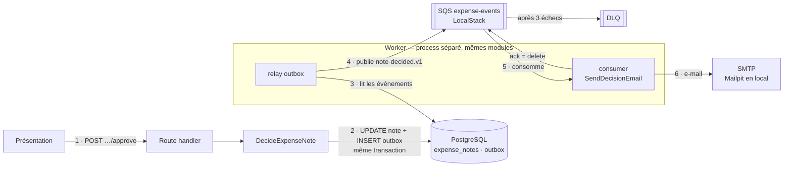
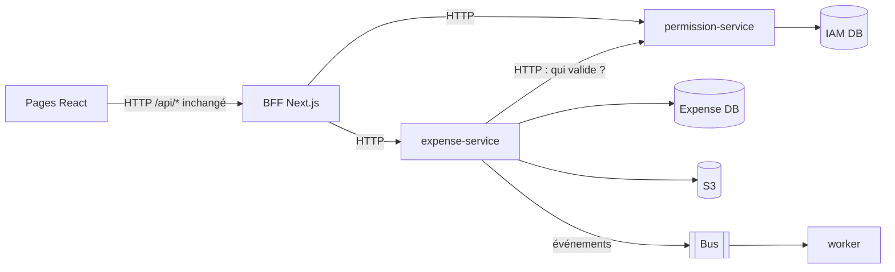

# Options d'architecture pour la refacto — Expense.io

> Étude d'options, préalable à l'ADR-001 · 09/10/2026 · base : `main` (`265924b`) + suite de caractérisation ARLA-9 (Vitest et Playwright, plus de 140 tests) · état des lieux : [`docs/audit/as-is.md`](../audit/as-is.md).

**En bref.** Quatre architectures cibles, de la plus légère à la plus lourde :

- **A.** Monolithe en couches, nettoyé (KISS).
- **B.** Monolithe modulaire par domaine, en hexagonale dans chaque module.
- **C.** B, plus un flux asynchrone : outbox, bus et worker.
- **D.** Microservices.

**Recommandation : C, livrée en deux jalons.** B d'abord, qui se suffit à lui-même. Ensuite l'asynchrone, limité à un seul flux (la notification de décision). D est décrite pour être écartée explicitement dans l'ADR.

## 1. Cadre de la décision

**La consigne** (cours 2) est une « refacto technique des différents composants de l'application » qui suit les guidelines du cours. Le cours cite deux exemples : la facturation en clean/hexa et l'unification des protocoles asynchrones. Ce code n'a ni facturation ni asynchrone (voir l'as-is). Les deux exemples ne s'appliquent donc pas tels quels.

| Contrainte | Source | Conséquence pour l'architecture |
|---|---|---|
| Ne pas casser l'API | kick-off, slides 4 et 10 | Les routes, les codes et les corps de réponse en succès restent identiques. Les `src/app/api/**/route.ts` restent en place : Next.js route sur ces fichiers et les tests d'intégration les importent par leur chemin. |
| 100 % des E2E verts | barème, « Contraintes techniques » /5 | La refacto avance par petits pas, chacun validé par la suite ARLA-9. |
| Refacto du 19 au 26/10, soutenance le 30/10 | kick-off, slide 7 | Environ une semaine de code : l'option doit tenir dans ce délai, ou se couper en jalons. |
| Live coding d'une feature inconnue avec l'IA | kick-off, slide 11 ; barème « Co-conception IA » /3 | L'architecture doit répondre à « où va le nouveau code ? » sans hésitation, pour l'équipe comme pour l'agent. |
| Audit chiffré avant / après | barème, « Audit » /5 | Chaque option doit produire des mesures comparables. |
| Un owner par axe (Architecture, Contrat d'API, Asynchrone & run) | kick-off, slides 8 et 12 | Une option qui laisse un axe vide l'affaiblit. |
| Échelle : SaaS B2B, aucune contrainte de charge connue | cours 2, tradeoffs | Rien ne justifie aujourd'hui un système distribué. |
| KISS : « l'absence d'architecture doit être un choix » | cours 2, slide 48 | Une option légère reste légitime si elle est justifiée. |

**Ce que la refacto doit régler** (points d'attention de l'as-is) :

1. RLS contournée.
2. Couche hexagonale morte et logique dupliquée : 4 handlers approve/reject presque identiques, mapping DTO copié 7 fois.
3. Contrôles d'accès inégaux (IDOR sur le reçu côté manager).
4. Secret codé en dur, stack renvoyée au client, injection via `?sort=`.
5. Robustesse : OCR dans le process web, note orpheline, rôle figé dans le JWT.
6. Industrialisation (déjà traitée par ARLA-9).

**Hypothèses**, à corriger si besoin :

- La taille de l'équipe n'est pas connue, donc les efforts sont donnés en jours-personne (j-p). Ce sont des estimations à recaler.
- Next.js et les pages React sont conservés : c'est une refacto technique, pas une réécriture.
- La facturation et OpenAI ne sont pas créés (YAGNI). On montre seulement où ils se brancheraient.
- La correction d'un défaut figé par un test `[as-is]` est un changement de test assumé (convention ARLA-9).

## 2. Socle commun, quelle que soit l'option

Ces corrections ne dépendent pas de l'architecture choisie. Elles relèvent du quadrant « Prioritaires » du mémo (isolation des clients, erreurs standard) et se font d'abord :

- **Isolation (point 1).** Un rôle Postgres applicatif qui n'est pas superutilisateur. Des policies RH filtrées par entreprise. La mise à jour de `receipt_key` passe dans le scope RLS. Index sur les clés étrangères.
- **Accès (point 3).** Vérification du rattachement sur `manager/…/receipt-url`. Contrôle de l'entreprise lors du rattachement d'un manager. 401 réservé à l'absence de session, 403 à un mauvais rôle.
- **Entrées et secrets (point 4).** `AUTH_SECRET` lu depuis l'environnement. Plus de stack dans les réponses. Liste blanche pour `?sort=`.
- **Contrat (axe API).** Le contrat OpenAPI de l'API actuelle est écrit d'abord (contract first), puis vérifié en CI avec `oasdiff`. Les erreurs passent en RFC 9457 de façon additive : on ajoute `type`, `title`, `status` et `detail`, et on garde `error`. Le changement est MINOR, pas MAJOR.

## 3. Les options

### Option A — Monolithe en couches, nettoyé (KISS)

**Principe.** On garde la forme actuelle et on la range. Les route handlers appellent des services, qui appellent des repositories SQL. La couche hexagonale morte est supprimée. Il n'y a pas de ports : les services utilisent `pg` et S3 directement.



```
src/
  app/api/**/route.ts          # parse → service → réponse HTTP
  server/
    expense-notes/  service.ts  repository.ts  dto.ts
    users/          service.ts  repository.ts
    http/           guard.ts  errors.ts
  lib/              auth.ts  db.ts  storage.ts  ocr.ts
  # domain/ ports/ adapters/ utils/ : supprimés
```

| | |
|---|---|
| **Règle** | Duplication : une fonction `decide()` remplace les 4 handlers, un seul mapper DTO remplace les 7 copies. Contrôles d'accès centralisés dans `guard.ts`. |
| **Ne règle pas** | Le métier reste couplé au SQL : les règles de validation vivent dans les `WHERE`. Les domaines restent mêlés : le service des notes connaît la hiérarchie. Aucune règle n'est testable sans base. Rien côté asynchrone. |
| **Effort / risque** | 3 à 4 j-p. Risque faible. |
| **Live coding** | On sait où mettre une route, pas où mettre une règle métier. |
| **Devant le jury** | Défendable par KISS (cours 2). En revanche, on ne montre ni découpage DDD ni hexagonale, alors que la consigne demande d'appliquer le cours. |

### Option B — Monolithe modulaire par domaine, hexagonal dans chaque module

**Principe.** C'est la cible de la slide 30 du cours 2 (« Monolithe Modulaire »). L'application reste un seul déployable, découpé en modules par domaine (DDD). Un module ne connaît les autres que par leur API publique. À l'intérieur, chaque module suit l'hexagonale :

- un domaine pur ;
- des use cases ;
- des ports définis par le métier ;
- des adapters (Postgres, S3, Tesseract, Auth.js, bcrypt).

Les route handlers Next.js deviennent des adapters primaires minces : ils lisent la requête, appellent un use case et traduisent le résultat en HTTP.



**Les modules :**

- **`expenses` (notes de frais).**
  - Agrégat `ExpenseNote` : machine d'états `pending → approved / rejected`. Elle existe déjà dans `src/domain`, mais n'est jamais utilisée.
  - Use cases : `SubmitExpenseNote`, `ListMyExpenseNotes`, `ListPendingApprovals`, `DecideExpenseNote` (remplace les 4 handlers), `GetReceiptUrl`, `SuggestFromReceipt`.
- **`iam` (permissions).**
  - Entités `User` et `Company`, rôles, hiérarchie.
  - Use cases : `SignUp`, `Authenticate`, `ListDirectory`, `AssignManager`.
  - Expose à `expenses` la politique de validation `ApprovalPolicy` : le valideur est le manager rattaché, ou les RH de l'entreprise pour un manager racine. Cette règle est aujourd'hui recopiée 7 fois dans le SQL des routes manager et RH, sans compter les policies RLS.
- **`shared`.** Erreurs métier traduites en RFC 9457, unité de travail (l'actuel `withUserScope`), horloge, logger.
- **Présentation.** `app/**/page.tsx` et `components/` restent inchangés et consomment l'API HTTP.
- **Facturation.** Aucun module n'est créé (YAGNI), mais son emplacement est connu : `modules/billing`, avec un port `PaymentProvider`. C'est une réponse prête pour une question du jury ou pour le live coding.

```
src/
  app/api/**/route.ts            # adapters primaires : parse → use case → HTTP
  modules/
    expenses/
      domain/          ExpenseNote.ts  errors.ts
      application/     submit-expense-note.ts  decide-expense-note.ts  …   # 1 fichier = 1 use case
      ports/           NoteRepository.ts  ReceiptStorage.ts  ReceiptReader.ts
      infrastructure/  PgNoteRepository.ts  S3ReceiptStorage.ts  TesseractReceiptReader.ts
      index.ts         # API publique + câblage (injection manuelle, sans framework)
    iam/
      domain/  application/  ports/  infrastructure/   # PgUserRepository, BcryptHasher, AuthJsSession
      index.ts
  shared/              errors/problem.ts  db/unit-of-work.ts  logger.ts
  lib/auth.ts          # reste le point d'entrée Auth.js (c'est lui que les tests d'intégration mockent)
```

**Règles de dépendance**, vérifiées en CI par `dependency-cruiser` (c'est aussi une mesure : nombre de violations avant / après) :

- `domain` n'importe rien.
- `application` importe seulement `domain` et `ports`.
- `infrastructure` implémente `ports`.
- Un module n'en importe un autre que par son `index.ts`.
- `app/` n'importe que des `index.ts`.

**Exemple de flux : la décision.**

1. `POST …/approve` appelle `decideExpenseNote({ actor, noteId, decision: 'approved' })`.
2. Le repository lit la note dans le scope RLS.
3. `iam.approvalPolicy.canDecide(actor, owner)` vérifie le droit de valider.
4. `note.approve()` applique la règle métier.
5. Le repository enregistre la note, qui est renvoyée en DTO.

Les routes manager et RH deviennent quatre adapters d'une dizaine de lignes, appuyés sur un seul use case.

| | |
|---|---|
| **Règle** | Point 2 : la couche hexagonale est enfin branchée. Point 3 : une seule politique d'accès. Point 5 en partie : le use case réserve la clé du reçu, l'envoie, puis insère la note dans une seule transaction, donc plus de note orpheline. Le rôle peut être relu en base plutôt que figé dans le JWT. |
| **Testabilité** | Les use cases se testent unitairement avec des repositories en mémoire (nouveaux tests). Les tests d'intégration restent tels quels, puisque les routes ne bougent pas. Les tests unitaires de `lib/ocr`, `lib/storage`, `lib/errors` et `lib/db` suivent leurs fichiers : seuls les imports changent. |
| **Effort / risque** | 6 à 8 j-p. Risque moyen, maîtrisé par la suite ARLA-9 si on migre une route à la fois. |
| **Live coding** | La recette est fixe : la règle dans `domain`, le use case, un port si besoin, son adapter, puis la route. On la documente dans `docs/architecture/conventions.md` et dans un `CLAUDE.md` / `AGENTS.md`, ce qui forme le harnais de l'agent. |
| **Devant le jury** | Correspond à la slide 30 du cours 2, au DDD et au principe « le métier ne dépend pas de la technique ». La couche morte est un bon fil narratif : des idées présentes mais mal implémentées (cours 2, slide 48). |
| **Limite** | Rien d'asynchrone. L'axe « Asynchrone & run » se réduit à un constat et à une décision justifiée de ne pas en faire. |

**Hexagonale ou Clean.** Pour le cours, les deux se valent (« bonnet blanc, blanc bonnet »). Recommandation : la terminologie hexagonale, déjà celle du dépôt (`ports/`, `adapters/`), avec un fichier par use case emprunté à Clean (« screaming architecture »). Ce niveau de guidage suffit pour que l'IA range le code de façon cohérente.

### Option C — B, plus un flux asynchrone (outbox, bus, worker)

**Principe.** On part de B et on ajoute un second process (le worker) et un bus de messages. Ils prennent en charge les effets de bord qui ne doivent pas bloquer la réponse HTTP, comme dans la cible des slides 39 et 40 du cours 2. Le premier flux est la **notification de décision** : un événement `NoteDecided` déclenche un e-mail à l'employé. Ce flux est retenu pour trois raisons :

- l'intention existe déjà (`NotificationPort`, jamais appelé) ;
- il apporte une fonctionnalité sans changer aucune réponse d'API ;
- c'est la cible de l'étude de cas (SMTP).



**Les composants, avec le vocabulaire du cours :**

- **Producer.** `DecideExpenseNote` écrit l'événement dans une table `outbox`, dans la même transaction que le changement de statut. La note et le message sont donc écrits ensemble, ou pas du tout (pattern outbox).
- **Broker.** SQS sur LocalStack, déjà présent dans le docker-compose : une file `expense-events`, plus une DLQ branchée par redrive policy (`maxReceiveCount: 3`).
- **Worker.** Un process Node séparé (`src/worker/main.ts`) qui réutilise les mêmes modules. Il relaie l'outbox, consomme les messages et envoie l'e-mail par un port `Mailer` (adapter SMTP, Mailpit en local). Supprimer le message vaut ack.
- **Garde-fous** (cours 2, slide 40) :
  - *Idempotence* : une table `processed_messages`. Un message rejoué n'envoie pas de second e-mail.
  - *Contract first* : le message est versionné (`expense.note-decided.v1`) et décrit en AsyncAPI ou JSON Schema.
  - *Traçabilité* : un `correlationId` suit la requête HTTP, l'outbox puis le worker, avec des logs JSON.
  - *DLQ*, décrite plus haut.

**Choix du broker :**

| Broker | Pour | Contre |
|---|---|---|
| **SQS (LocalStack) + outbox** — recommandé | Pas de nouvelle infra. Chaque notion du cours est visible (producer, broker, worker, ack, DLQ). Correspond à une vraie cible de production (AWS). | Un composant de plus (le relay) et une table outbox. |
| pg-boss (file dans Postgres) | Plus simple : l'envoi se fait dans la même transaction, sans relay, et la dead letter est intégrée. | Le broker se confond avec la base, ce qui rend la démonstration moins lisible. |

**Extension, seulement en cas d'avance.** L'OCR passe en asynchrone, avec un nouvel endpoint `202 Accepted` suivi par polling (cours 3, slide 14). L'endpoint synchrone actuel est conservé, donc le changement est MINOR. Cela sort enfin Tesseract du process web.

| | |
|---|---|
| **Règle** | Tout ce que règle B. En plus : les notifications (absentes aujourd'hui), le découplage des effets de bord lents ou faillibles, et un axe « Asynchrone & run » concret. |
| **Mesures** | Latence de `…/approve` inchangée malgré l'envoi d'e-mail. Un test d'idempotence : un message rejoué produit 1 seul e-mail. Un test de DLQ : un SMTP en panne envoie le message en DLQ après 3 essais. |
| **Effort / risque** | Effort de B, plus 4 à 6 j-p. Les E2E existants ne sont pas touchés, puisque l'API ne change pas. Il faut ajouter le worker et Mailpit au docker-compose et à la CI, ainsi qu'un E2E qui lit la boîte Mailpit. |
| **Devant le jury** | Couvre les trois axes. On attend la question « pourquoi de l'asynchrone ici ? ». Réponse : l'e-mail est un effet de bord non critique, et un SMTP lent ne doit pas faire échouer une décision (« la résilience du système est celle de son maillon le plus lent »). On limite l'asynchrone à un flux, parce que le cours demande de toujours en questionner l'utilité. |

### Option D — Microservices

**Principe.** C'est la cible des slides 31 et 34 du cours 2 :

- un service de présentation : Next.js en BFF, qui garde les routes `/api/*` publiques pour ne pas casser le contrat ;
- un `expense-service` et un `permission-service`, chacun avec sa base (Expense DB, IAM DB) ;
- des appels HTTP (ou gRPC) entre services, un JWT vérifié par chaque service ;
- un bus et un worker pour l'asynchrone.



| | |
|---|---|
| **Coûts propres** | Séparer les bases casse les jointures `expense_notes ⨝ users` sur lesquelles reposent toutes les files d'attente et la RLS. Il faut alors soit un appel à l'IAM à chaque liste (latence, N+1), soit une réplication des utilisateurs, avec de la cohérence à terme. La soumission devient une transaction distribuée. Il faut un tracing distribué (OpenTelemetry), et le compose comme la CI passent à plus de 5 conteneurs. Les E2E deviennent plus lents et plus fragiles. |
| **Effort / risque** | Plus de 20 j-p. Le risque est fort de ne pas finir avant le 26/10 et d'avoir des E2E rouges le jour J. |
| **Live coding** | Une feature qui touche deux services demande un changement de contrat interne et deux déploiements. |
| **Devant le jury** | Le cours le classe lui-même dans « À reconsidérer : tout passer en microservices » (mémo, slide 17) et rappelle qu'une architecture distribuée complique le déploiement et le monitoring. Aucune contrainte réelle ne le justifie : ni la charge, ni l'autonomie d'équipes, ni des déploiements indépendants. **À présenter comme alternative écartée dans l'ADR** : c'est là qu'elle montre la posture d'architecte. |

## 4. Comparaison

| Critère | A · Couches | B · Modulaire + hexa | C · B + async | D · Microservices |
|---|---|---|---|---|
| Effort estimé | 3 à 4 j-p | 6 à 8 j-p | 10 à 14 j-p | plus de 20 j-p |
| Risque pour l'API et les E2E | faible | moyen, migration route par route | moyen, l'API reste inchangée | fort |
| Découplage des domaines (DDD) | non | oui | oui | oui, physique |
| Métier testable sans infra | non | oui | oui | oui |
| Axe « Asynchrone & run » | vide | justifié par un constat | traité (outbox, DLQ, idempotence, traçabilité) | traité, au prix d'un système distribué |
| Complexité d'exploitation | 1 process | 1 process | 2 process + 1 file | plus de 5 conteneurs, tracing distribué |
| Prévisibilité pour le live coding IA | moyenne | forte | forte | faible |
| Alignement avec le cours | KISS seulement | slide 30, DDD, hexa | slides 30, 39, 40, cours 3 | contredit le mémo (slide 17) |
| Mesures avant / après | duplication | duplication, couplage, violations de dépendances | idem B + latence, DLQ, idempotence | difficile dans le délai |

## 5. Recommandation : C en deux jalons

1. **Jalon 1, du 19 au 23/10 : socle commun et option B.** Les routes migrent une par une vers les use cases, et la suite ARLA-9 reste verte à chaque commit. Ce jalon se suffit à lui-même : si on s'arrête là, le livrable est cohérent.
2. **Jalon 2, du 23 au 26/10 : l'incrément asynchrone de C, sur le seul flux de notification.** L'OCR en `202` n'est fait que si on est en avance.

**Pourquoi :**

- Chaque axe et chaque owner a un livrable concret.
- Chaque choix s'appuie à la fois sur une slide du cours et sur un défaut mesuré dans l'as-is.
- La décision reste réversible. B est la base de C, et l'incrément asynchrone (un worker, deux tables) peut être retiré sans toucher l'API.

**Si l'équipe manque de temps :** on livre B seul, et l'axe asynchrone devient une décision documentée de ne pas en faire (le cours admet ce choix s'il est argumenté). A est écartée parce qu'elle ne montre pas les notions du cours. D est écartée pour les raisons ci-dessus.

**Mesures à prendre avant la refacto** (même outillage avant et après) :

- duplication (`jscpd`) ;
- complexité (règle ESLint `complexity`) ;
- violations de dépendances (`dependency-cruiser`) ;
- couverture (déjà en place) ;
- nombre de tests `[as-is]` encore rouges sur le plan fonctionnel ;
- latence p95 de la soumission et de la décision.

## 6. Après le choix

- Rédiger l'**ADR-001** (court) : la décision, son contexte, les alternatives A, B, C et D avec un renvoi vers ce document, et les conséquences.
- Dessiner le **schéma cible** au format Excalidraw, dans le style de [`as-is.excalidraw`](../audit/as-is.excalidraw), pour le comparer à l'as-is pendant la soutenance.
- Trancher les sous-choix : le broker (SQS ou pg-boss), la terminologie (hexagonale ou Clean), l'extension OCR en `202`.
- Écrire le design détaillé (modules, ports, ordre de migration des routes), puis le plan d'implémentation, réparti par owner.
