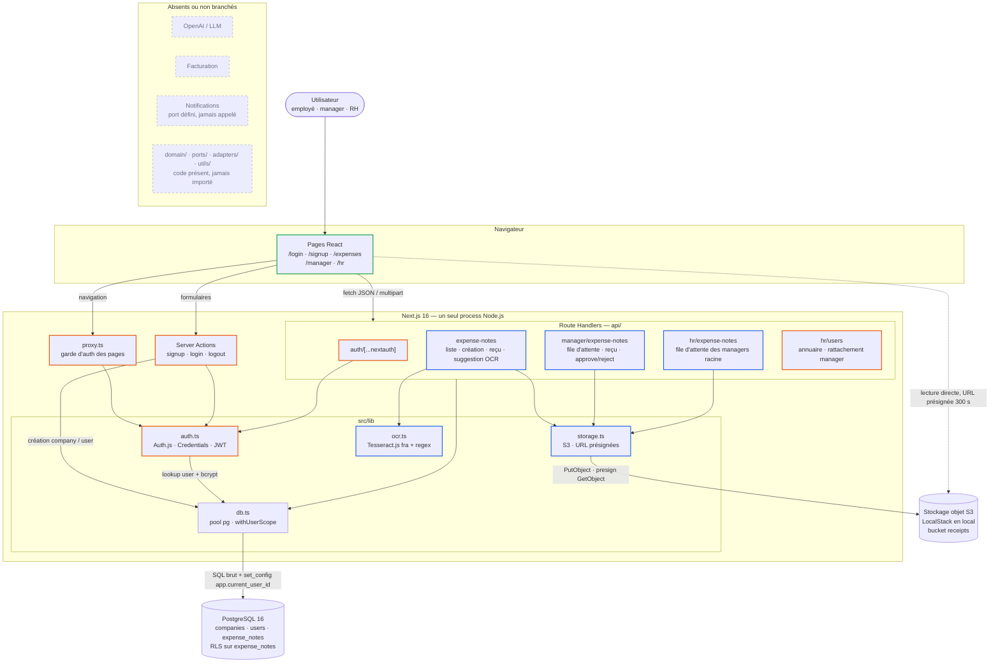

# Architecture actuelle (as-is) — Expense.io

> Audit · ticket ARLA-8 · état au commit `265924b` (08/10/2026) · périmètre : tout le dépôt `expense-io`.

**En bref.** Monolithe Next.js 16 (App Router, TypeScript) : un seul process Node.js sert l'UI React, l'API interne et tous les traitements (authentification, OCR, upload). Il s'appuie sur PostgreSQL et sur un stockage objet S3. Tout est synchrone. L'application n'appelle aucun service tiers en SaaS : pas d'OpenAI, pas de facturation, pas de notifications.

## Schéma

Une version éditable et plus détaillée est disponible dans [`as-is.excalidraw`](as-is.excalidraw). Elle comporte deux vues : la vue d'ensemble, avec les points d'attention numérotés, et le flux de soumission d'une note. Pour l'ouvrir, utiliser excalidraw.com (*Open*) ou l'extension VS Code Excalidraw.

Bordures : **bleu** = notes de frais, **orange** = permissions, **vert** = présentation, **pointillés** = absent ou non branché.

## Stack

| Couche | Technologie | Remarque |
|---|---|---|
| Runtime | Node.js 24+, Next.js 16.3.5 (App Router), React 19.2 | un seul déployable ; ni Dockerfile applicatif ni cible de prod décrite |
| UI | Tailwind CSS 4, composants client (`'use client'`), polices Geist via `next/font/google` | pas de bibliothèque de composants |
| Auth | Auth.js (`next-auth` 5.0.0-beta.32), provider Credentials, session JWT, bcryptjs | dépendance en version bêta |
| Données | PostgreSQL 16, driver `pg` en SQL brut, `node-pg-migrate` | pas d'ORM ; une seule migration |
| Fichiers | AWS SDK v3 (S3 + presigner) ; LocalStack 3.8 en local | clés `receipts/<receipt_seq>.<ext>` |
| OCR | `tesseract.js` 7, modèle `tessdata/fra.traineddata.gz` versionné dans le dépôt | exécuté dans le process web |
| Outillage | ESLint 9, `tsc --noEmit`, Makefile, docker-compose, scripts `seed` / `ensure-bucket` | aucun test, aucune CI dans le dépôt |

**Services externes.** Le seul service externe est le stockage objet S3 : LocalStack en local, aucune cible de production configurée. **OpenAI** n'est pas utilisé : la suggestion montant/date repose sur un OCR Tesseract local et des regex, sans appel réseau (`src/lib/ocr.ts`). Il n'y a **pas de facturation** : aucune table, route ou SDK (Stripe ou autre), aucune notion de plan. Les **notifications** se limitent à un stub : `NotificationPort` et `ConsoleNotificationAdapter` existent, mais rien ne les appelle.

## Découpage par domaine

| Domaine | Responsabilités | Emplacement |
|---|---|---|
| **Notes de frais** | saisie, upload du reçu, suggestion OCR, historique, décision `pending → approved / rejected` | `api/expense-notes/**`, `api/manager/expense-notes/**`, `api/hr/expense-notes/**`, `lib/storage.ts`, `lib/ocr.ts`, table `expense_notes` |
| **Permissions** | authentification, rôles, hiérarchie, multi-entreprise | `lib/auth.ts`, `proxy.ts`, `app/actions/auth.ts`, `api/hr/users/**`, `lib/db.ts` (`withUserScope`), policies RLS de la migration |
| **Facturation** | — | inexistant |
| **Présentation** | pages, navigation selon le rôle, appels `fetch` vers l'API | `app/**/page.tsx`, `app/layout.tsx`, `components/*` |

Les règles de permissions, telles que le code les applique :

- **Rôles.** Il en existe trois : `employee`, `manager`, `hr_admin`. Le rôle `manager` ne s'attribue que par le seed ou en SQL.
- **Entreprises.** Une entreprise correspond à un domaine email (`companies.email_domain`). Le premier inscrit d'un domaine devient `hr_admin`, les suivants `employee`.
- **Circuit de validation.** Le manager désigné par `manager_id` valide les notes de la personne qui lui est rattachée. Les RH valident les notes des managers racine (`manager_id IS NULL`). Deux cas n'ont aucun valideur : les employés sans manager (c'est le cas de tout nouvel inscrit tant que les RH ne l'ont pas rattaché) et les `hr_admin`.
- **Contrôle d'accès, en trois couches :**
  1. `proxy.ts` vérifie seulement qu'une session existe, sur `/expenses`, `/manager` et `/hr` (les routes `/api` sont exclues).
  2. Chaque route handler lit le rôle dans le JWT et filtre en SQL (`user_id`, `manager_id`, `company_id`).
  3. PostgreSQL applique une RLS sur `expense_notes` uniquement. Elle s'appuie sur `app.current_user_id`, que `withUserScope` positionne.

## Flux

Tout passe par des requêtes HTTP synchrones dans le process Next.js. Il n'y a ni file de messages, ni worker, ni cron, ni webhook. Le seul asynchronisme est celui des `fetch` côté navigateur.

| Flux | Chemin | Nature |
|---|---|---|
| Inscription, connexion | Server Action → `companies` / `users` → Auth.js pose un cookie JWT (id + rôle) | sync |
| Soumission d'une note | `POST /api/expense-notes` (multipart) → `INSERT` (transaction RLS) → `PutObject` S3 → `UPDATE receipt_key` (hors transaction) | sync, 3 étapes non atomiques |
| Pré-remplissage OCR | `POST /api/expense-notes/receipt-suggestion` → un worker Tesseract créé puis détruit à chaque requête | sync, CPU dans le process web |
| Consultation d'un reçu | `GET …/receipt-url` → URL présignée de 300 s → le navigateur lit S3 directement | sync, navigateur ↔ S3 |
| Décision | `POST /api/{manager,hr}/expense-notes/:id/{approve,reject}` → `SELECT` + `UPDATE` en transaction | sync, aucune notification émise |
| Rattachement hiérarchique | `PUT /api/hr/users/:id/manager` → `UPDATE users.manager_id` | sync |
| Bootstrap local | `make dev` : compose → migrations → bucket → seed → `next dev` | scripts ponctuels |

## Points d'attention relevés pendant la cartographie

Ces constats sont à qualifier dans les tickets d'audit suivants.

1. **La RLS est contournée en pratique** (constat déduit de la configuration ; non vérifié à l'exécution, Docker n'étant pas lancé). L'image `postgres` crée `POSTGRES_USER` (`expense`) en superutilisateur, et un superutilisateur ignore la RLS, même avec `FORCE`. L'application en dépend d'ailleurs sans le dire : `src/app/api/expense-notes/route.ts:103` met à jour `receipt_key` via `getPool()`, hors `withUserScope`, alors qu'aucune policy `UPDATE` propriétaire n'existe. Avec un rôle non privilégié, la soumission d'une note échouerait. Par ailleurs, les policies RH ne filtrent pas par entreprise.
2. **La couche hexagonale est morte.** `src/domain`, `src/ports`, `src/adapters` et `src/utils` ne sont importés nulle part. La logique métier est dupliquée dans les route handlers : quatre handlers approve/reject quasi identiques, et le mapping DTO copié sept fois.
3. **Les contrôles d'accès sont inégaux.** `api/manager/expense-notes/[id]/receipt-url/route.ts:17` ne vérifie pas le rattachement : n'importe quel manager obtient le reçu de n'importe quelle note. `api/hr/users/[id]/manager/route.ts:40` ne vérifie pas que le manager choisi appartient à la même entreprise. Enfin, un mauvais rôle renvoie 401 côté manager et 403 côté RH.
4. **Secrets, erreurs et entrées.** Le secret `AUTH_SECRET` est codé en dur (`src/lib/auth.ts:8`) et la variable d'environnement est ignorée. `respondError` renvoie la stack au client (`src/lib/errors.ts:5`). Le paramètre `?sort=` est concaténé dans un `ORDER BY` (`src/app/api/expense-notes/route.ts:46`).
5. **Robustesse.**
   - L'OCR tourne en synchrone, dans le process web, sans limite de taille (`src/lib/ocr.ts:106`).
   - Si l'upload S3 échoue, la note reste orpheline avec `receipt_key = ''`.
   - Le rôle reste figé dans le JWT jusqu'à la reconnexion.
   - Les clés étrangères (`user_id`, `manager_id`, `company_id`) n'ont pas d'index.
6. **Industrialisation.** Le dépôt ne contient ni tests, ni CI, ni cible de déploiement. Les logs se limitent à `console.*`.
